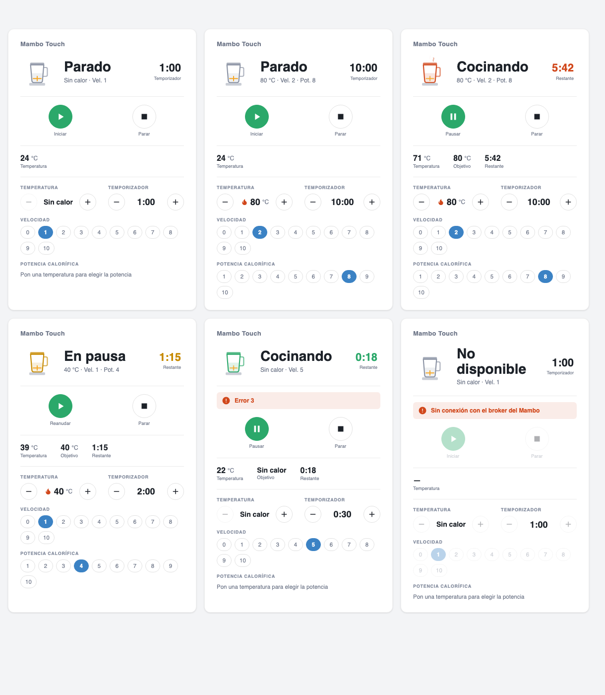
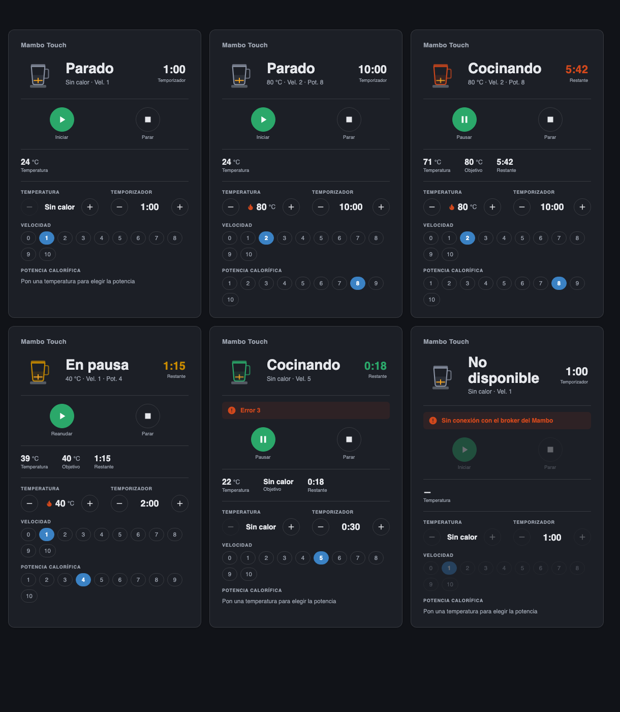

# Mambo HUD Card

An instrument-panel Lovelace card and a Home Assistant integration for the
**Cecotec Mambo Touch** food processor: state, time left, temperature,
start / pause / stop, and the temperature, speed, heat power and timer set
points in one panel. Recipes are out of scope.

It's the sibling of the [Vacuum HUD Card](https://github.com/pablopeza/vacuum-hud-card)
and shares its look.





> ⚠️ **This is a heating appliance with blades.** The card asks for a second
> tap before it starts a cook with heat, and the integration won't start
> without a timer, but nobody can see the jar from a dashboard. Only start it
> when someone is next to it, and with the lid on.

## How it works

The Mambo Touch has no local API: it only talks to the KitchenIdea cloud over
**MQTT 5 without TLS**. The `mambo_touch` integration logs in to the same
broker with the robot's MQTT credentials and its **own random client id**
(using the robot's id would kick the robot off), listens to the robot's
reports and sends the same binary commands as the official app.

So this needs the cloud, and the credentials have to be captured from the
robot's own traffic first (they're in the MQTT `CONNECT` packet). There is
no account login.

| Piece | What |
|---|---|
| `custom_components/mambo_touch` | Integration: connection, entities, commands |
| `mambo-hud-card.js` | Lovelace card, a single file without a build step |

## Installation

Not published yet. By hand:

1. Copy `custom_components/mambo_touch` to `config/custom_components/` and
   restart Home Assistant.
2. Settings → Devices & services → Add integration → **Mambo Touch**: broker
   (`3.71.50.36`), port (`1883`), username, password and the robot's device
   id (`mboTouch…`).
3. Copy `mambo-hud-card.js` to `config/www/` and add it as a resource:
   Settings → Dashboards → **⋮** → Resources → `/local/mambo-hud-card.js`,
   type JavaScript Module.
4. Add the card ("Mambo HUD Card") from the card picker: the editor fills in
   the integration's entities.

## Entities

| Entity | Notes |
|---|---|
| `sensor.*_status` | `stopped`, `cooking`, `paused`; `unknown` until the robot reports (it says nothing while idle) |
| `sensor.*_temperature` | Current temperature of the jar |
| `sensor.*_time_left` | Seconds left of the running cook |
| `sensor.*_error_code` | 0 = no error (diagnostic) |
| `binary_sensor.*_broker_connection` | Connection to the broker (diagnostic) |
| `number.*_target_temperature` | 0 = no heat, else 37-120 °C |
| `number.*_speed` | 0-10 |
| `number.*_heat_power` | 1-10, only with heat. Set from the temperature (40 °C → 4) unless changed |
| `number.*_timer` | Seconds, up to 12 h. Needed to start |
| `button.*_start` / `_pause` / `_resume` / `_stop` | |

The set points live in Home Assistant until the cook starts. While a cook
runs, changes to temperature, speed and heat power are sent to the robot at
once (the timer isn't); if someone turns the knob on the robot, the set
points follow it.

## Card configuration

Add it from the card picker, or with YAML. Only `entity` (the status sensor)
is required; every block hides itself when its entities aren't set.

```yaml
type: custom:mambo-hud-card
entity: sensor.mambo_touch_status
temperature: sensor.mambo_touch_temperature
remaining: sensor.mambo_touch_time_left
error: sensor.mambo_touch_error_code
connected: binary_sensor.mambo_touch_broker_connection
target_temperature: number.mambo_touch_target_temperature
speed: number.mambo_touch_speed
power: number.mambo_touch_heat_power
timer: number.mambo_touch_timer
start: button.mambo_touch_start
pause: button.mambo_touch_pause
resume: button.mambo_touch_resume
stop: button.mambo_touch_stop
```

| Option | Default | Description |
|---|---|---|
| `name` | device name | Card title |
| `show_controls` | `true` | Start / pause / resume / stop buttons |
| `show_setpoints` | `true` | Temperature, timer, speed and heat power |

## Protocol

Every message is `55 01 01 <class> <len:2> <field> <ts:4> <sum:1>`, where the
field is `<id> <type> <len:2> <value>` and the last byte is the sum of all the
previous ones modulo 256. Commands go to `kitchenidea/U/D/<device id>` and
reports come on `kitchenidea/D/P/<device id>`. Details and the captured
messages are in [`protocol.py`](custom_components/mambo_touch/protocol.py)
and [`tests/`](tests).

What's still unconfirmed on the real robot: **resume** (`02 02 00 00 00`, the
same as start) and the set point changes during a cook.

## Tests

```bash
python3 -m unittest discover -s tests   # protocol tests run anywhere
```

The client tests need Home Assistant installed (they're skipped otherwise);
they never publish anything.

## License

MIT
